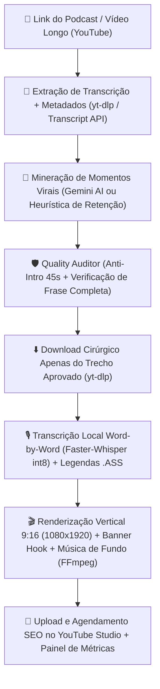

# 🎬 AutoShorts Pipeline — Automação de Cortes Virais para YouTube Shorts (9:16)

Pipeline 100% automatizado para **minerar**, **auditar**, **transcrever**, **editar em formato vertical 9:16 (1080x1920)** com **legendas dinâmicas estilo karaokê (`.ass`)**, **mixar trilha sonora de fundo** e **publicar/agendar automaticamente no YouTube Studio** (com integração opcional ao Google Drive, Google Calendar e Google Sheets).

> 🔒 **Repositório Limpo (Zero Credenciais):** Este repositório não contém nenhuma chave de API, token OAuth ou informação pessoal. Siga o guia abaixo para conectar sua própria conta do Google/YouTube em poucos minutos.

---

## ⚙️ Como o Sistema Funciona (Arquitetura)



### Principais Módulos (`src/`):
1. **`src/podcast_cutter.py`**: Motor central que baixa trechos específicos de vídeos longos, gera legendas dinâmicas `.ass` (estilo Hormozi/Shorts com até 4 palavras por bloco + banner superior de gancho nos primeiros 3.5s) e renderiza em `1080x1920` via `FFmpeg` com mixagem automática de trilha sonora (`assets/music/`).
2. **`src/quality_auditor.py` (`ClipQualityAuditor`)**: Guardrail de qualidade que bloqueia cortes ruins antes da renderização:
   - **Filtro Anti-Intro**: Descarta automaticamente os primeiros 45 segundos de episódios longos e bloqueia termos de abertura (*"seja bem-vindo"*, *"deixe seu like"*, *"solta a vinheta"*).
   - **Verificador de Frase Completa**: Rejeita cortes que terminam com conjunções ou palavras suspensas (*"porque..."*, *"mas..."*, *"então..."*, *"né?"*), garantindo início, meio e fim narrativo.
   - **Trava de Duração Shorts**: Garante que todo corte tenha entre **25s e 58s**.
3. **`src/google_services.py`**: Integração oficial OAuth 2.0 com as APIs do Google (**YouTube Data API v3**, **Google Drive API**, **Google Calendar API** e **Google Sheets API**).
4. **`src/cli.py`**: Interface de linha de comando (`Typer` + `Rich`) para autenticar a conta, gerar cortes avulsos ou em lote e consultar métricas em tempo real.
5. **`.agents/skills/`**: Conjunto de Skills especializadas de engenharia de retenção e crescimento no YouTube (`yt-shorts`, `yt-viral`, `yt-package`, `yt-seo`, `yt-retention`, `yt-script`, `yt-edit`, `yt-audit`).

---

## 🛠️ Ferramentas e Pré-requisitos Necessários

Antes de rodar o projeto, certifique-se de ter instalado na sua máquina:

1. **Python 3.11 ou superior**
   - [Baixar Python](https://www.python.org/downloads/)
2. **`uv` (Gerenciador de pacotes Python ultra-rápido — Recomendado)**
   - Windows (PowerShell): `powershell -ExecutionPolicy ByPass -c "irm https://astral.sh/uv/install.ps1 | iex"`
   - Linux/macOS: `curl -LsSf https://astral.sh/uv/install.sh | sh`
3. **FFmpeg (Obrigatório para corte de vídeo, áudio e queima de legendas `.ass`)**
   - Windows (WinGet): `winget install Gyan.FFmpeg`
   - Ubuntu/Debian: `sudo apt update && sudo apt install -y ffmpeg fonts-dejavu-core fonts-liberation`
   - macOS (Homebrew): `brew install ffmpeg`
4. **Git**
   - [Baixar Git](https://git-scm.com/)
5. **Conta no Google Cloud Console** (Gratuita) para gerar seu arquivo `client_secret.json` e conectar seu canal do YouTube.
6. **Chave de API do Google Gemini** *(Opcional, gratuita no [Google AI Studio](https://aistudio.google.com/apikey))*.

---

## 🔧 Passo a Passo de Configuração (Do Zero)

### Passo 1: Clonar o Repositório e Instalar Dependências
```bash
git clone https://github.com/pikdaglx/autoshorts-pipeline.git
cd autoshorts-pipeline

# Cria o ambiente virtual (.venv) e instala todas as dependências automaticamente
uv sync
```
*(Alternativa sem `uv`: `python -m venv .venv`, ative o ambiente e rode `pip install -e .`)*

### Passo 2: Configurar o Arquivo `.env`
Copie o arquivo de exemplo `.env.example` para `.env`:
```bash
# Linux / macOS
cp .env.example .env

# Windows (PowerShell)
Copy-Item .env.example .env
```
Abra o arquivo `.env` e, se desejar usar a IA do Gemini para escolher os cortes, preencha sua `GEMINI_API_KEY`. Caso deixe em branco, o sistema usará automaticamente o algoritmo heurístico de retenção + `Faster-Whisper` local.

### Passo 3: Configurar Credenciais OAuth 2.0 no Google Cloud (Para Upload no YouTube)
Para que o sistema possa postar e agendar vídeos no seu canal do YouTube (e opcionalmente salvar no Drive/Sheets/Calendar):

1. Acesse o [Google Cloud Console](https://console.cloud.google.com/) e crie um **Novo Projeto**.
2. No menu lateral, vá em **APIs e Serviços ➔ Biblioteca** e ative as seguintes APIs:
   - **YouTube Data API v3** *(Obrigatória)*
   - **Google Drive API** *(Opcional - para backup dos vídeos)*
   - **Google Sheets API** *(Opcional - para planilha de métricas)*
   - **Google Calendar API** *(Opcional - para calendário de postagens)*
3. Vá em **APIs e Serviços ➔ Tela de permissão OAuth (OAuth consent screen)**:
   - Escolha **Externo (External)**, preencha o nome do app (ex: `AutoShorts`) e seu e-mail.
   - Na seção **Usuários de teste (Test users)**, **adicione o e-mail da sua conta do Google/YouTube**.
4. Vá em **APIs e Serviços ➔ Credenciais ➔ + Criar Credenciais ➔ ID do cliente OAuth**:
   - Tipo de aplicativo: **App para computador (Desktop app)**.
   - Clique em **Criar** e faça o **Download do JSON**.
5. Renomeie o arquivo baixado para **`client_secret.json`** e coloque-o na **raiz deste projeto** (use o arquivo `client_secret.example.json` como referência de formato).

### Passo 4: Fazer Login e Gerar o `token.json`
Com o `client_secret.json` na raiz do projeto, execute:
```bash
uv run python -m src.cli login
```
O navegador será aberto automaticamente. Faça login com a conta do seu canal do YouTube, marque as permissões e confirme. O arquivo `token.json` será salvo localmente e renovado automaticamente sempre que necessário.

Para confirmar que seu canal está conectado:
```bash
uv run python -m src.cli auth
```

---

## 🚀 Como Usar na Prática

### 1. Gerar Corte Automático e Publicar/Agendar no YouTube
```bash
# Minera o melhor momento viral do podcast, renderiza em 9:16 e envia como privado
uv run python -m src.cli clip "https://www.youtube.com/watch?v=ID_DO_VIDEO"

# Gera 3 cortes virais do mesmo episódio e publica imediatamente como público
uv run python -m src.cli clip "https://www.youtube.com/watch?v=ID_DO_VIDEO" --count 3 --privacy public

# Gera 1 corte e agenda para uma data/hora específica (formato ISO UTC)
uv run python -m src.cli clip "https://www.youtube.com/watch?v=ID_DO_VIDEO" --privacy private --publish-at "2026-11-15T18:00:00Z"
```

### 2. Gerar um Corte com Minutagem, Título e Hook Personalizados
```bash
uv run python -m src.cli clip "https://www.youtube.com/watch?v=ID_DO_VIDEO" \
  --start 1240 \
  --end 1292 \
  --title "O Maior Segredo dos Negócios | Podcast" \
  --hook "🚨 ELE REVELOU O SEGREDO" \
  --privacy public
```

### 3. Apenas Renderizar na Máquina (Sem Upload para o YouTube)
```bash
uv run python -m src.cli clip "https://www.youtube.com/watch?v=ID_DO_VIDEO" --no-upload
```
Os vídeos prontos ficarão salvos na pasta `./output/`.

### 4. Consultar Métricas do Canal em Tempo Real
```bash
uv run python -m src.cli metrics
```
Exibe uma tabela formatada no terminal com todos os vídeos recentes do seu canal, status (`PÚBLICO` / `AGENDADO`), visualizações, curtidas e taxa de engajamento (%).

---

## 🤖 Prompt Pronto para Configurar e Operar via Agente IA / MCP

Se você utiliza um assistente de código com suporte a MCP / Terminal (como **Antigravity**, **Cursor**, **Claude Code** ou **Windsurf**), basta copiar e colar o prompt abaixo para que o agente instale, configure e opere todo o sistema para você:

```markdown
Quero que você instale, configure e opere o projeto AutoShorts Pipeline na minha máquina para produzir e postar cortes virais no meu canal do YouTube Shorts.

1. CLONAR, CRIAR MEU REPOSITÓRIO PRIVADO NO GITHUB E INSTALAR:
- Clone o repositório base: `git clone https://github.com/pikdaglx/autoshorts-pipeline.git`
- Entre na pasta `autoshorts-pipeline`.
- Desvincule o remote original (`git remote remove origin`) e crie um novo repositório **PRIVADO** na minha própria conta do GitHub (usando `gh repo create autoshorts-pipeline --private --source=. --remote=origin --push` ou configurando a URL do meu repositório privado no GitHub) para que somente eu tenha acesso ao meu projeto e às minhas automações.
- Verifique se o `ffmpeg`, `python` (>=3.11), `gh` (GitHub CLI) e `uv` estão instalados no sistema (se faltar algum, instale via winget/apt/brew ou crie um `.venv` padrão).
- Rode `uv sync` para instalar todas as dependências do `pyproject.toml` (incluindo `faster-whisper`, `yt-dlp`, `google-api-python-client`, `google-genai`, `typer`, `rich`).
- Copie `.env.example` para `.env` (garanta que `.env`, `client_secret.json` e `token.json` jamais sejam enviados ao Git, pois já estão protegidos no `.gitignore`).

2. CONFIGURAR CREDENCIAIS:
- Verifique se já coloquei o meu arquivo `client_secret.json` (OAuth 2.0 Desktop App do Google Cloud) na raiz do projeto. Se ainda não estiver lá, me avise e me guie para colocar.
- Assim que o `client_secret.json` estiver na raiz, execute `uv run python -m src.cli login` para abrir o navegador e autenticar minha conta do YouTube/Google, gerando o `token.json`.
- Em seguida, rode `uv run python -m src.cli auth` para confirmar o nome do meu canal conectado.

3. COMO OPERAR A PRODUÇÃO DIÁRIA DE CORTES (SEMPRE SIGA ESTAS REGRAS):
- Leia as skills dentro de `.agents/skills/` (`yt-shorts`, `yt-viral`, `yt-package`, `yt-seo`, `yt-retention`) antes de planejar os lotes.
- Priorize SEMPRE episódios e assuntos RECENTES e em alta nos grandes podcasts.
- Todo corte DEVE passar pelo módulo `ClipQualityAuditor` (`src/quality_auditor.py`):
  * Nunca faça cortes nos primeiros 45 segundos do vídeo (evitar vinhetas, intros e pedidos de like).
  * Nunca termine um corte em palavra suspensa ou frase incompleta ("porque...", "mas...", "né?").
  * Mantenha a duração entre 30 e 58 segundos.
- Use `Faster-Whisper` local (`int8`) para gerar timestamps palavra por palavra, construa legendas dinâmicas `.ass` (`build_ass_subtitles`) com headline de gancho no topo e renderize em 1080x1920 vertical com `render_short_916_with_subtitles`.
- Sempre consulte `uv run python -m src.cli metrics` para analisar quais nichos estão tendo mais visualizações e engajamento no meu canal antes de produzir o próximo lote!
```

---

## 📄 Licença & Termos
Consulte os arquivos [PRIVACY.md](PRIVACY.md) e [TERMS.md](TERMS.md) para detalhes sobre o uso das APIs do Google OAuth.
